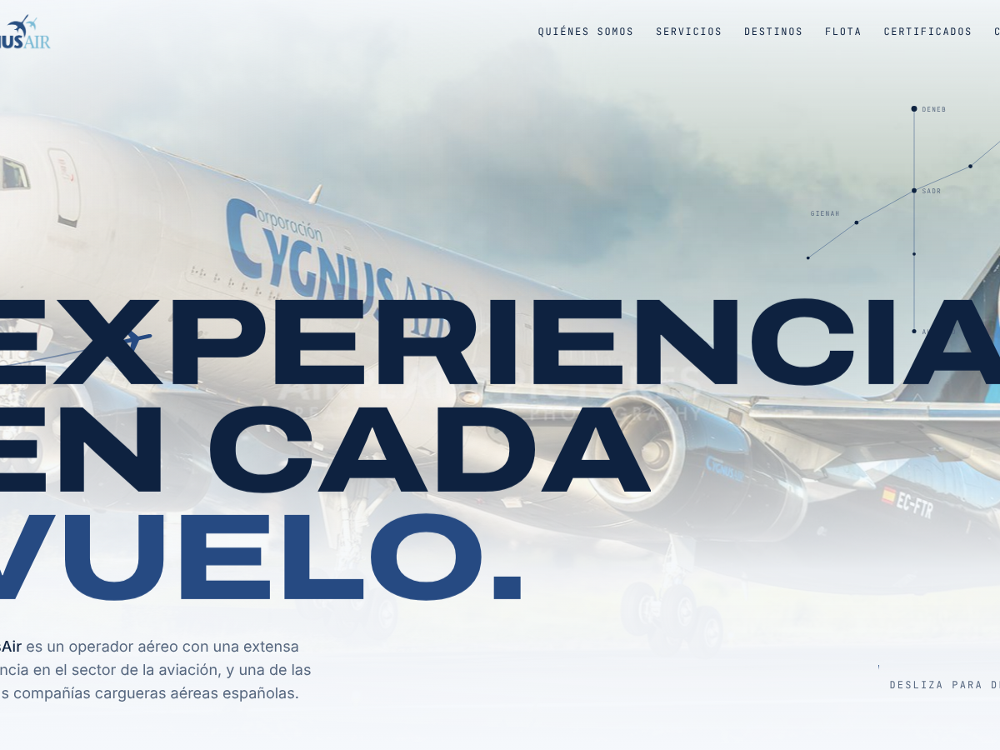

# Cygnus Air · tema de WordPress

Tema a medida para **Cygnus Air** (ygnusair.com): una sola página con movimiento. El menú lleva a cada sección (Quiénes somos, Servicios, Destinos, Flota, Certificados y Contacto). La flota se edita desde el panel, hay un comunicado de emergencia que se activa con una casilla y las páginas legales vienen incluidas.



---

## 1. Instalar en un WordPress nuevo (por ejemplo, nuevaweb.ygnusair.com)

1. En IONOS, crea el subdominio apuntando a una carpeta vacía, activa el SSL e instala WordPress en él.
2. En **Ajustes → Lectura**, marca **«Disuadir a los motores de búsqueda de indexar este sitio»** mientras sea la web de pruebas.
3. **Apariencia → Temas → Añadir nuevo → Subir tema** → `cygnusair.zip` → **Instalar ahora** → **Activar**.

Al activarse, el tema deja hecho lo siguiente:

- Crea las páginas **Aviso legal**, **Política de privacidad** y **Política de cookies** con sus textos, enlazadas entre sí y desde el pie y el formulario.
- Crea el primer avión de la flota, el **Boeing 757-200PCF**, con su foto, su ficha técnica y su PDF.
- Pone **info@ygnusair.com** como correo que recibe el formulario de contacto.
- Deja el **comunicado de emergencia** con el texto de ejemplo y **activado**, para enseñárselo al cliente. Se quita en el paso 2 del apartado siguiente.
- Activa los enlaces del tipo `/aviso-legal/` y borra «¡Hola, mundo!» y la página de ejemplo de WordPress (solo si no se han tocado).

No hace falta crear menús ni la portada: la portada es la página de inicio del tema.

## 2. Uso diario (panel de WordPress)

### Flota
**Flota → Añadir avión.** Escribe el nombre (por ejemplo, «Boeing 737-800BCF»), elige la foto en «Foto del avión» y rellena la ficha técnica. Las cifras van sin unidades y con coma para los decimales (`47,32`); en la web se animan. Los campos que se dejen vacíos no se muestran. El PDF se sube con «Elegir o subir PDF». El orden se cambia en «Atributos → Orden» (primero el número más bajo).

Cada avión aparece en la flota horizontal con su animación. El texto de la entrada de la flota nombra solo los modelos que haya publicados.

### Comunicado de emergencia
**Apariencia → Comunicado y contacto.**

- **Activar:** marca «Mostrar el comunicado en la web», escribe el título, la fecha y hora, el texto y, si lo hay, el teléfono para familiares. Después pulsa **Guardar cambios**.
- **Quitar:** desmarca la casilla y pulsa **Guardar cambios**.

Mientras está activo:

- se abre una ventana sobria al entrar en cualquier página;
- queda una franja gris fija arriba para volver a leer el comunicado;
- la web pasa a modo sereno: sin animaciones ni aviones en movimiento y en escala de grises;
- en la barra superior del panel aparece un aviso rojo «Comunicado activo», para que no se olvide.

Si quien lo lee lo cierra, no vuelve a salirle en esa visita, salvo que se cambie el texto.

### Formulario de contacto
Los mensajes llegan al correo indicado en la misma pantalla, por defecto info@ygnusair.com. Al responder, se responde directamente a quien escribió.

Si en IONOS los correos no llegan, instala un complemento de SMTP (por ejemplo **WP Mail SMTP**) con una cuenta de correo del dominio. El tema no necesita nada más.

### Textos legales
Son páginas normales: **Páginas → Aviso legal**, etc. Se editan como cualquier página.

### Logotipo
El tema trae el logotipo. Para cambiarlo: **Apariencia → Personalizar → Identidad del sitio → Logo**.

## 3. Qué hay en la web

| Sección | Movimiento |
|---|---|
| Entrada | Pantalla de carga con contador y el nombre letra a letra |
| Portada | Foto del 757 despegando, la constelación del Cisne (Cygnus) que se dibuja sola y un avión que cruza el cielo |
| Cinta | Palabras en bucle que aceleran y se inclinan con la velocidad del scroll |
| Quiénes somos | El párrafo se ilumina palabra a palabra; contadores animados |
| Servicios | «Plan de vuelo»: un avión recorre solo las cinco fases y va iluminando cada servicio, con altímetro, velocidad y rumbo |
| Destinos | El mapa se abre en círculo desde Madrid y un avión vuela a cada destino |
| Flota | Desplazamiento horizontal con la ficha animada de cada avión e historia de la flota |
| Galería | Fotos que se descubren como una cortina y con parallax |
| Certificados | Banda azul con seis tarjetas de licencia que entran girando y se inclinan con el ratón |
| Contacto | Un avión despega tras el título; botón magnético y formulario |

Quien tenga activada en su sistema la opción «reducir movimiento» ve la web quieta.

## 4. Para quien desarrolle

```
cygnusair/              el tema (lo que va dentro del .zip)
  front-page.php        la portada completa
  inc/aviones.php       tipo de contenido «Avión» y su ficha
  inc/ajustes.php       Apariencia → Comunicado y contacto
  inc/contacto.php      envío del formulario
  inc/activacion.php    lo que se crea al activar el tema
  inc/legal/            textos legales de las páginas que se crean
  assets/css/main.css   diseño (generado desde la propuesta)
  assets/css/wp.css     ajustes para WordPress
  assets/js/main.js     animaciones de la portada (generado desde la propuesta)
  assets/js/crisis.js   comunicado de emergencia (todas las páginas)
  assets/js/vendor/     GSAP 3.12.5 y Lenis 1.1.13
propuesta/              maqueta HTML en un solo archivo (origen del diseño)
tools/build-zip.sh      crea cygnusair.zip
tools/sync-theme-assets.py  pasa CSS, JS, fotos y textos legales de la propuesta al tema
```

Crear el `.zip`:

```bash
./tools/build-zip.sh
```

GitHub también lo crea solo en cada cambio de `main`: pestaña **Actions → Empaquetar tema → cygnusair-tema**.

Si se cambia el diseño en la propuesta (`propuesta/src/index.html`), se pasa al tema con:

```bash
npm install
python3 tools/sync-theme-assets.py
```

Librerías: [GSAP](https://gsap.com) (ScrollTrigger y MotionPath) y [Lenis](https://lenis.darkroom.engineering), incluidas en el tema. Las fuentes (Archivo, Inter y JetBrains Mono) se cargan de Google Fonts.
